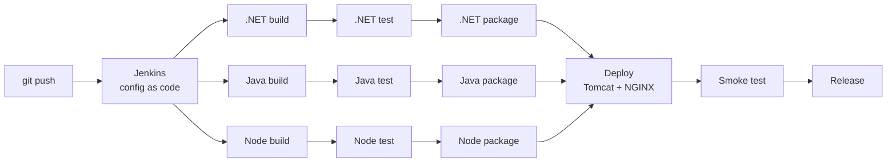

# Legacy Jenkins pipelines redesigned

Three microservices in three languages (.NET, Java and Node.js) built, tested, packaged and deployed by **one declarative Jenkinsfile and a shared library**, instead of a hand-maintained job per service with manual steps in between.
Every push runs it on a **real Jenkins**, started fresh inside GitHub Actions and configured entirely as code.

[Live pipeline →](https://danielkojomegbenu.com/projects/jenkins-pipeline-redesign)

## The pipeline



| Service | Language | Runs on | Behind NGINX at |
|---|---|---|---|
| catalog | .NET 10 (minimal API, xUnit) | Kestrel | `/catalog/` |
| orders | Java 21 (servlet WAR, JUnit) | **Tomcat** 10.1 | `/orders/` |
| cart | Node.js 24 (`node:test`) | Node | `/cart/` |

## What the redesign changed

| Before (legacy) | After (this repo) |
|---|---|
| One freestyle job per service, configured by hand in the UI | One `Jenkinsfile` in Git, reviewed like code |
| The same build steps copy-pasted, then drifting | One shared library, `jenkins/shared-library/vars/svc.groovy`: `svc.build`, `svc.test`, `svc.pack`, `svc.deploy`, `svc.smoke`, `svc.release` |
| Services built one after another | All three built, tested and packaged **in parallel** |
| Manual copy to Tomcat and an NGINX reload by hand | `svc.deploy` deploys all three and puts NGINX in front, then `svc.smoke` checks them through NGINX |
| Build tools installed on the Jenkins machine | Each step runs in its toolchain container (.NET SDK, Maven, Node), so the Jenkins machine needs only Docker |
| Jenkins configured by clicking | Jenkins, its plugins, the library and the job are all code: `jenkins/` |

Adding a fourth service is one line in the `services` list of the `Jenkinsfile`.

## How GitHub Actions shows Jenkins

GitHub Actions only hosts the run:

1. It starts Jenkins from `jenkins/` (`docker compose up`).
2. It triggers the `redesign` job.
3. It has **one step per Jenkins stage**. Each step waits for that stage's marker in the Jenkins console and prints the stage's lines.

So the steps in GitHub Actions, and the live diagram on the case study page, follow the Jenkins stages one by one. The full Jenkins console log is attached to every run.

## See a broken test stop one line

Open the pull request **demo/java-breaking-change**. It changes the Java service so one of its tests fails.
The .NET and Node.js lines carry on in parallel, but the Java line stops at **Java test**, and nothing is deployed.

## Run it on your machine

```bash
git checkout -B jenkins-run
docker compose up -d --build
bash scripts/jenkins.sh wait-ready && bash scripts/jenkins.sh trigger
```

Open http://localhost:8090 (admin / admin) and watch the `redesign` job. When it's done, the services are at http://localhost:8088/catalog/products, `/orders/list` and `/cart/items`.

## What's in the repo

| Path | What it is |
|---|---|
| `Jenkinsfile` | The redesigned pipeline |
| `jenkins/shared-library/vars/svc.groovy` | The reusable steps for every language |
| `jenkins/Dockerfile`, `plugins.txt`, `casc.yaml` | Jenkins, its plugins, the library and the job, as code |
| `services/catalog`, `services/orders`, `services/cart` | The .NET, Java and Node.js services and their tests |
| `gateway/default.conf` | NGINX in front of all three |
| `scripts/jenkins.sh` | Starts, triggers and follows the Jenkins build |
| `.github/workflows/jenkins.yml` | The GitHub Actions run that hosts Jenkins |

## Cost

Free. Jenkins only exists for the length of a run, and GitHub Actions is free for public repos.
